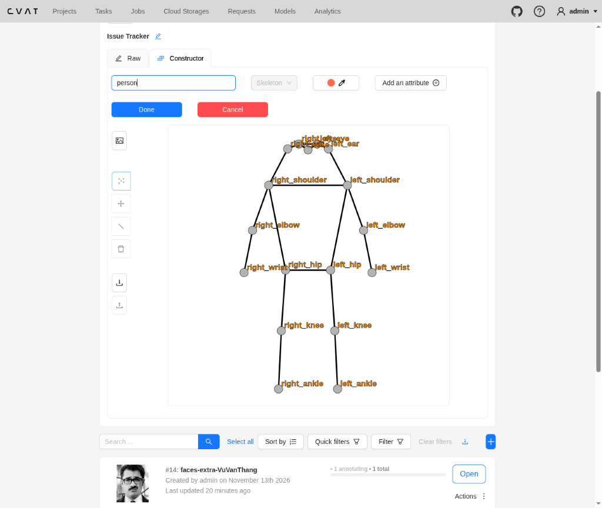
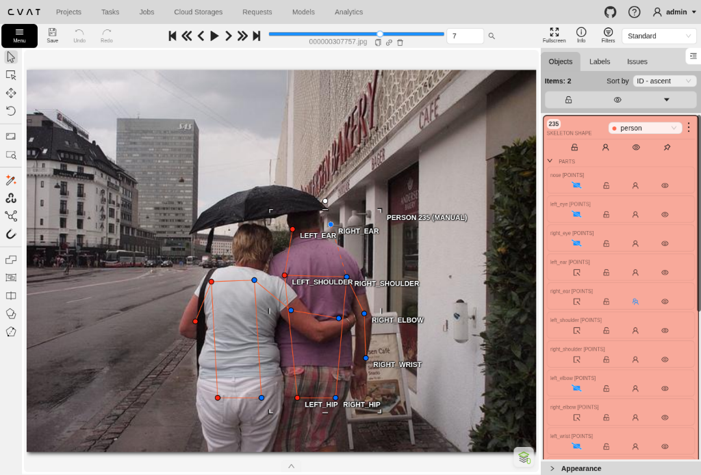
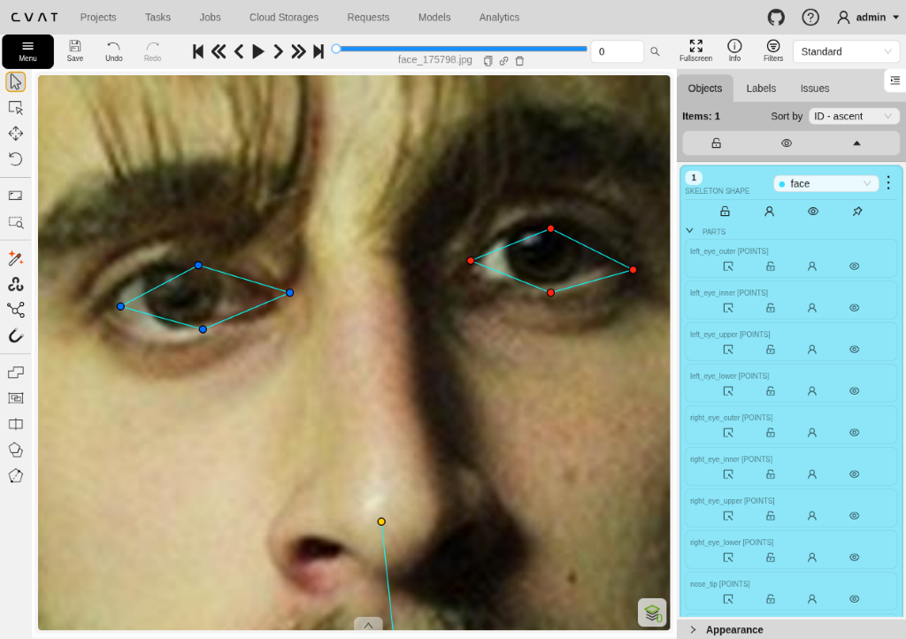
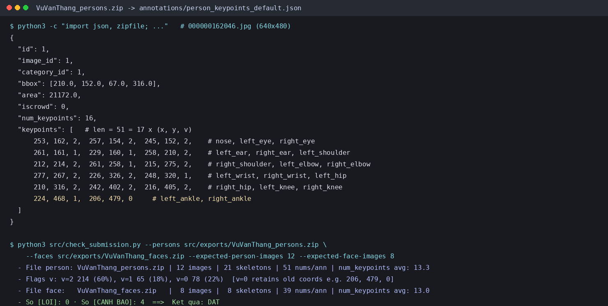

# Báo cáo cá nhân — VuVanThang-2A202603239

Dữ liệu: 12 ảnh người COCO val2017 / train2017 (Lin et al., 2014) và 8 ảnh chân dung cắt từ ảnh COCO, chỉ dùng trong lớp.

## 0. Thông tin học viên

- Họ tên: Vũ Văn Thắng (`VuVanThang`)
- MSSV: `2A202603239`
- Email: `Yusei1708@users.noreply.github.com`
- Link repository: https://github.com/Yusei1708/K5-L2-DAY04-VuVanThang-2A202603239-KeypointPose
- Phiên bản CVAT (Help → About): `2.82.1`
- Máy: hệ điều hành Linux (Kernel 6.18.60-1-lts) · RAM 16 GB · chạy CVAT chế độ đầy đủ (`core` + `cvat_clickhouse`)
- Bộ ảnh (`src/exports/assignment.json` do `lab.py setup` tạo): có (`pool_version: d04-k5-v2`)
- Giờ bắt đầu: 11:54 (GMT+7, 2026-11-13)
- Giờ kết thúc: 13:05 (GMT+7, 2026-11-13)

## 1. Kiểm tra label (CP0)

| Label | Kiểu | Số điểm | Tên điểm đúng bảng của lab? | Đúng thứ tự? | Số cạnh |
|---|---|---:|---|---|---:|
| `person` | `skeleton` | 17 | Có (17/17 tên chuẩn COCO) | Có (1 → 17) | 19 |
| `face` | `skeleton` | 13 | Có (13/13 tên chuẩn của lab) | Có (1 → 13) | 13 |

Mẫu `person` dựng theo người quay mặt về camera (các điểm `left_*` nằm bên phải khung mẫu)? Có

Cách đổi cờ `occluded` / `outside` cho **một điểm** trên phiên bản CVAT này (một câu):

Rê chuột vào đúng một điểm của skeleton để điểm sáng lên rồi bấm phím `Q` (bật/tắt `occluded`, `v = 1`) hoặc phím `O` (bật/tắt `outside`, `v = 0`), hoặc chuột phải vào điểm đó để chọn trực tiếp trong menu ngữ cảnh (không dùng `hidden` / phím `H`).

## 2. Số lượng đã gán và thời gian (CP1, CP2)

| Nhóm ảnh | Số ảnh | Số skeleton đã gán | Số người dưới 60 px (không gán) | Số poster / gương / màn hình bỏ qua | Thời gian (phút) |
|---|---:|---:|---:|---:|---:|
| `easy` | 5 | 5 | 0 | 0 | 8 |
| `occluded` | 3 | 6 | 0 | 0 | 12 |
| `back` | 2 | 4 | 6 | 0 | 7 |
| `small` | 1 | 3 | 7 | 0 | 6 |
| `crowd` | 1 | 3 | 0 | 0 | 7 |
| `faces` | 8 | 8 | — | 0 | 16 |

- Số ảnh người đã xong trước mốc phút 105: 12 / 12 (21 skeleton `person`)
- Thời gian thực tế (phút): CP1 40 · CP2 16 · CP3 15 (tổng 71 phút, 11:54–13:05)
- Ảnh tốn thời gian nhất là ảnh nào, vì sao?

`000000542160.jpg` (`crowd`) và `000000220045.jpg` (`occluded`) tốn nhiều thời gian nhất vì các cầu thủ/người đi bộ chồng lấp nhau sát mép thân (cần phóng to vùng đầu chồng nhau và dò từng ống quần/tất/giày để phân biệt đúng người, đúng chiều `left`/`right` và đúng cờ `v = 1` vs `v = 0`).

## 3. Bảng ca khó (CP1, CP2)

Mỗi điểm bạn phân vân một dòng, nhất là phân vân giữa `v = 1` và `v = 0`, hoặc không chắc hướng người.

| Ảnh | Người / mặt | Điểm | Cờ đã chọn | Phân vân giữa | Lý do chọn |
|---|---|---|---|---|---|
| `000000162046.jpg` | `person #1` | `right_ankle` | `v = 0` | `v = 1` và `v = 0` | Ống quần bên phải đi sát xuống tận mép dưới ảnh (`y = 479`), cổ chân thực tế nằm ở/dưới biên dưới khung hình; chọn `v = 0` (`outside`) thay vì ép điểm vào mép ảnh. |
| `000000179201.jpg` | `person #1`, `#2` | `hip`, `knee`, `ankle` | `v = 0` | `v = 1` và `v = 0` | Toàn bộ phần dưới từ thắt lưng trở xuống bị bàn kotatsu và chăn dày che kín, không thể ước lượng tư thế ngồi (duỗi, khoanh hay quỳ) trong khoảng ±15 px nên đặt `v = 0`. |
| `000000163118.jpg` | `person #2` (`#76`) | `left_wrist` | `v = 1` | `lr_swap` / vị trí | Cánh tay trái vắt ngang trước ngực (phía khuất máy ảnh) khiến cổ tay/bàn tay ló sang bên phải thân sát nách phải (`x=363`); đã kiểm tra độ dài cẳng tay (`~49 px`) để xác nhận thuộc `left_wrist`. |
| `000000220045.jpg` | `person #1` | `left_eye`, `right_eye` | `v = 1` / `v = 0` | `v = 1` và `v = 0` | Người đi trước đeo kính râm tối màu và quay nghiêng trái: mắt trái (`gần camera`) đoán được sau tròng kính qua gọng kính (`v = 1`), còn mắt phải ở phía khuất sống mũi + kính tối nên đặt `v = 0`. |
| `000000307757.jpg` | `person #1`, `#2` | `left_knee`..`right_ankle` | `v = 0` | `v = 1` và `v = 0` | Cả hai người quay lưng đều bị cắt ảnh ngang đùi / ngay trên gối ở mép dưới `y = 480`; khớp gối và cổ chân nằm ngoài khung ảnh nên đặt `v = 0`. |
| `000000269462.jpg` | `person #1`, `#2`, `#3` | `right_knee`, `right_ankle` | `v = 0` | `v = 1` và `v = 0` | Chân phải của cả 3 cảnh sát kỵ binh bị thân ngựa che hoàn toàn ở phía đối diện (không quan sát được vị trí bàn đạp phải) nên đặt `v = 0`. |
| `000000542160.jpg` | `person #1` (`#4`), `#3` (`#2`) | `nose`, `left_*`/`right_*` | `v = 2` / `v = 1` | Hướng quay người | Cầu thủ `#4` quay lưng (`left` bên trái) nhưng quay đầu sang phải; cầu thủ `#2` đứng nghiêng ngực sang trái (`left` phía camera / bên phải ảnh) nên phải đối chiếu vị trí số áo và găng tay. |
| `face_294580.jpg` | `face #1` | 8 điểm mắt (`left_eye_*`, `right_eye_*`) | `v = 1` | `v = 1` và `v = 0` | Cả hai mắt bị tròng kính râm tối che hoàn toàn; tuy nhiên sống mũi, cung mày và gọng kính giúp ước lượng vị trí hốc mắt nằm trọn trong ảnh với sai số nhỏ hơn ~15 px nên đặt `v = 1` (`occluded`). |
| `face_380639.jpg` | `face #1` | `*_eye_upper`, `*_eye_lower` | `v = 2` | Vị trí mi trên/dưới | Người nhìn xuống khiến hai mí mắt khép gần sát nhau; phóng to 2x để đặt cặp `upper`/`lower` tách nhẹ 3–4 px dọc theo đường lông mi thay vì trùng khít một pixel. |
| `face_415073.jpg` | `face #1` | `right_eye_*`, `nose_tip`, `mouth_left` | `v = 2` | Cỡ mắt xa và mép miệng | Mặt nghiêng 3/4 làm mắt phải (gần mép trái) thu hẹp rõ rệt và khóe `mouth_left` kéo gần nếp cười má; đặt đúng khóe môi kết thúc chứ không kéo dài ra nếp nhăn. |
| `face_442231.jpg` | `face #1` | `lip_upper`, `lip_lower`, `mouth_*` | `v = 2` | Vùng môi mím/chu | Đang ăn pizza nên môi chu và hơi xoay nghiêng; phân biệt ranh giới môi trên (`lip_upper`) với nhân trung và khóe môi thu hẹp (`mouth_left`/`mouth_right`). |

## 4. Bảng tự review (CP3)

Đi từ ảnh cuối về ảnh đầu. 5 ảnh người (ít nhất 2 ảnh `back` hoặc `crowd`) và 3 ảnh mặt. Ít nhất 8 dòng, kể cả dòng `ok`. Ghi lỗi trước, sửa sau.

Mã lỗi dùng đúng một trong: `lr_swap`, `vis_flag`, `position`, `missing`, `extra`, `ok`.

| Ảnh | Người / mặt | Điểm | Mã lỗi | Ghi chú | Đã sửa? |
|---|---|---|---|---|---|
| `000000542160.jpg` | `person #3` (`#2`) | `nose`, `left_ankle` | `position` | Kiểm lại từ ảnh cuối: chỉnh `nose` đúng chóp mũi dưới lưỡi trai và `left_ankle` xuống đúng cổ giày sau. | Có |
| `000000307757.jpg` | `person #1` | `right_elbow` | `position` | Ban đầu khuỷu phải lệch mép ngoài; đã chỉnh vào đúng nếp khuỷu tay áo vòng ôm bạn đồng hành. | Có |
| `000000269462.jpg` | `person #2` | `right_ankle` | `extra` | Gắn nhầm mũi giày người đi bộ phía sau cho chân phải bị thân ngựa che của kỵ sĩ `#2`; đã đặt `v = 0` (`outside`). | Có |
| `000000220045.jpg` | `person #1` | `left_shoulder`, `right_ankle` | `ok` | Dáng bước nghiêng làm hai vai gần chồng chiều ngang nhưng đúng bên cơ thể (`left`/`right` không bị đảo). | Có |
| `000000163118.jpg` | `person #1` (áo xám `#76`) | `left_wrist`, `right_wrist` | `ok` | Tay trái vắt ngang trước ngực sát nách phải (`x = 363`) trong khi tay phải giơ cao đón đĩa (`x = 337`), gây cảnh báo L/R nhưng đúng theo giải phẫu lưng áo `#76`. | Có |
| `000000162046.jpg` | `person #1` | `right_ankle` | `vis_flag` | Cổ chân phải tụt sát biên dưới (`y = 479`), chuyển từ cân nhắc `v = 1` sang `v = 0` (`outside`) để không ép sát mép khung hình. | Có |
| `face_559185.jpg` | `face #1` | 13 điểm mặt | `ok` | Ảnh nhìn thẳng rõ nét, toàn bộ viền mi, cánh mũi và khóe môi khớp đúng chi tiết giải phẫu trên overlay 2x. | Có |
| `face_415073.jpg` | `face #1` | `left_eye_upper`, `mouth_left` | `position` | Hạ `left_eye_upper` 4 px về đúng viền lông mi trên và thu `mouth_left` vào đúng khóe miệng (tránh trôi ra nếp má). | Có |
| `face_380639.jpg` | `face #1` | `lip_upper`, `right_eye_outer` | `position` | Hạ `lip_upper` xuống đúng viền đỏ môi trên (`y = 376`) và dịch `right_eye_outer` xuống đúng khe đuôi mắt nhắm (`y = 247`). | Có |
| `face_294580.jpg` | `face #1` | `left_eye_*` (`4` điểm) | `position` | Giữ nguyên cờ `v = 1` (`occluded`), dịch cụm mắt trái xuống ~5 px vào giữa tròng kính đen dưới cung mày để cân xứng với góc nghiêng đầu. | Có |

Tổng hợp số lỗi theo mã:

| `lr_swap` | `vis_flag` | `position` | `missing` | `extra` | `ok` |
|---:|---:|---:|---:|---:|---:|
| 0 | 1 | 5 | 0 | 1 | 3 |

Điểm còn phân vân giữa `v = 1` và `v = 0` (ghi cả hai lựa chọn và lý do chọn):

- **`face_294580.jpg` (`face #1`, 8 điểm mắt sau kính râm đen)**: Phân vân giữa `v = 1` (ước lượng được trong vùng tròng kính) và `v = 0` (tròng phản quang tối che hoàn toàn đồng tử/mi mắt). Chọn **`v = 1`** vì phần hốc mắt, sống mũi, đuôi lông mày và độ nghiêng miệng giúp khoanh vùng mắt chính xác trong khoảng sai số nhỏ hơn ~15 px ngay bên trong khuôn mặt.
- **`000000162046.jpg` (`person #1`, `right_ankle`)**: Phân vân giữa `v = 1` (cổ chân nằm sát mép dưới ảnh) và `v = 0` (nằm ở/ngoài biên dưới `y = 479`). Chọn **`v = 0`** vì khớp mắt cá bị cắt ngay viền ảnh nên dễ tạo nhãn giả nếu ép tọa độ nằm gọn trên mép khung.

## 5. Kiểm file xuất và kết quả tự kiểm (CP4)

Tự kiểm tay trong file JSON:

| File | Người / mặt kiểm (ảnh, thứ tự) | Số phần tử `keypoints` | Điểm `outside` ra `v = 0`, `occluded` ra `v = 1`? | `num_keypoints` khớp? |
|---|---|---:|---|---|
| `VuVanThang_persons.zip` | `000000162046.jpg` (`person #1`, `ann#1`) | 51 | Có (`right_ankle` `v = 0`; 5 điểm `v = 1`) | Có (`num_keypoints = 16`, khớp 16 điểm `v > 0`) |
| `VuVanThang_persons.zip` | `000000179201.jpg` (`person #1`, `ann#4`) | 51 | Có (6 điểm chân `v = 0`; 3 điểm mặt/tay `v = 1`) | Có (`num_keypoints = 11`, khớp 11 điểm `v > 0`) |
| `VuVanThang_faces.zip` | `face_294580.jpg` (`face #1`, `ann#3`) | 39 | Có (8 điểm mắt `v = 1`, 0 điểm `v = 0`) | Có (`num_keypoints = 13`, khớp 13 điểm `v > 0`) |

Sau khi xuất, CVAT ghi `occluded` thành `v = 1` và `outside` thành `v = 0`. Tọa độ của điểm `outside` trong file là `0, 0` hay tọa độ cũ? **Tọa độ cũ** (`CVAT 2.82.1` giữ nguyên cặp `[x, y]` trước khi gắn cờ `outside`, ví dụ `[206.0, 479.0, 0]` hoặc `[590.0, 355.0, 0]`, thay vì đưa về `0, 0`).

Hai job đã chuyển sang completed trên CVAT? **Có** (Job `11` và Job `12` đều đã chuyển sang trạng thái `completed` trên CVAT).

Dán phần **TÓM TẮT** in ra từ `src/check_submission.py`:

```text
----- TÓM TẮT (dán vào báo cáo mục 5) -----
- File person: VuVanThang_persons.zip
  Số ảnh: 12 · số skeleton `person`: 21 · mỗi annotation 51 số
  Skeleton theo ảnh: 000000162046=1, 000000163118=2, 000000179201=2, 000000220045=2, 000000269462=3, 000000292999=1, 000000302102=2, 000000307757=2, 000000429594=1, 000000445187=1, 000000451084=1, 000000542160=3
  Cờ v: v=2 214 (60%) · v=1 65 (18%) · v=0 78 (22%)
  num_keypoints trung bình: 13.3
- File face: VuVanThang_faces.zip
  Số ảnh: 8 · số skeleton `face`: 8 · mỗi annotation 39 số
  Skeleton theo ảnh: face_175798=1, face_249336=1, face_294580=1, face_380639=1, face_415073=1, face_421231=1, face_442231=1, face_559185=1
  Cờ v: v=2 96 (92%) · v=1 8 (8%) · v=0 0 (0%)
  num_keypoints trung bình: 13.0
- Ghi chú: 78 điểm v = 0 vẫn mang tọa độ cũ (CVAT 2.x xuất như vậy; chuẩn COCO ghi 0, 0). Không phải lỗi: điểm v = 0 bị bỏ qua khi huấn luyện và khi chấm.
- Số [LỖI]: 0 · số [CẢNH BÁO]: 4
Kết quả: ĐẠT (đọc lại từng cảnh báo ở trên)
```

Các `[CẢNH BÁO]` còn giữ nguyên và lý do:

- `000000163118.jpg #1` (`cặp wrist`, áo xám `#76`): Người chơi quay lưng giơ tay phải thẳng lên đón đĩa (`x = 337`) đồng thời vắt tay trái ngang trước ngực ló sang sát nách phải (`x = 363`), nên `left_wrist` nằm bên phải `right_wrist` theo đúng tư thế giải phẫu, không phải `lr_swap`.
- `000000163118.jpg #2` (`cặp ankle`, áo cam `#13`): Khi bật nhảy trên không xoay người sang phải, chân phải phía gần camera đá hơi lùi sang trái (`x = 171`) che nhẹ trước cổ chân trái (`x = 180`), nên hai cổ chân bắt chéo nhẹ ngược chiều vai/hông, không phải `lr_swap`.
- `000000220045.jpg #1` (`cặp shoulder`): Người đi trước xoay nghiêng người sang trái khiến vai phải hơi nhô về phía trước (`x = 275`) so với vai trái (`x = 305`) ngược dấu ngang với chân phải sải dài ra phía sau (`x = 564` so với `left_ankle` `x = 391`), không phải `lr_swap`.
- `000000292999.jpg #1` (`cặp elbow, wrist`): Cầu thủ bóng chày giữ chày bằng cả hai tay đưa sang phía trước ngực về bên phải ảnh (`x = 322..342`), khiến khuỷu và cổ tay phải với tới cầm phần tay nắm cao hơn về phía ngoài bên phải, bắt chéo thật khi vung chày, không phải `lr_swap`.

## 6. Ảnh chụp màn hình

1. Label `person` trong label constructor (đủ 17 điểm có tên):

   

2. Một người quay lưng đã gán, cờ đã đặt:

   

3. Một khuôn mặt đã gán 13 điểm, phóng to vùng mắt:

   

4. Một đoạn JSON xuất của một người:

   

Nguồn ảnh: COCO val2017 / Wikimedia Commons.

## 7. Tự đánh giá

1. Lỗi bạn mắc nhiều nhất hôm nay, và cách bạn sẽ tránh ở dự án thật:

   Lỗi hay gặp nhất là lệch vị trí cục bộ vài pixel ở những điểm ranh giới mảnh hoặc bị che nhẹ (`position` — như `left_eye_upper`/`mouth_left` trên ảnh nghiêng `face_415073.jpg`, `mouth_right` dưới ria mép `face_102517.jpg`, hoặc cổ chân/đầu gối sát mép vật thể) và nguy cơ nhầm `left`/`right` hoặc gắn nhầm chi người khác (`extra`) ở ảnh đông người / quay lưng (`000000337458.jpg`, `000000269462.jpg`). Trong dự án thật, cần tuân thủ: (i) luôn phóng to vùng mặt/khớp 2x–3x trước khi chấm điểm, (ii) áp dụng nhất quán quy ước trái/phải theo giải phẫu chủ thể ngay khi gắn từng cặp điểm, và (iii) bắt buộc kiểm tra tự động hình học trái/phải kết hợp self-review ngược từ ảnh cuối về ảnh đầu cho từng batch.

2. Một quy tắc bạn đề xuất thêm vào guideline (kèm ảnh ví dụ nếu có):

   Đề xuất bổ sung **Quy tắc biên cắt & ngưỡng bất định giữa `v = 1` và `v = 0`**: *"Khi tâm giải phẫu của khớp bị cắt ngay rìa khung ảnh (cách biên ảnh `<= 2 px`, ví dụ `y >= height - 2` trên `000000162046.jpg`, `000000196853.jpg`), không ép điểm vào trong viền ảnh để gán `v = 1` mà bắt buộc gắn **`v = 0` (`outside`)**. Tương tự khi bị vật lớn hoặc râu dày che kín (`000000179201.jpg`, `face_68290.jpg`), nếu không nhìn thấy khe khớp/đường biên nào để khoanh vùng trong `±15 px` thì thống nhất đặt `v = 0` thay vì đoán mò `v = 1`."* Quy tắc này giúp thống nhất tiêu chuẩn gán nhãn giữa các thành viên trong nhóm.

3. Nhãn của bạn đi vào model ở đâu? Chọn một lỗi bạn đã sửa và nói nó sẽ làm model học sai thế nào (heatmap, trọng số trong loss, hay bước lật ảnh):

   Bộ ba `(x, y, v)` của mỗi keypoint đi trực tiếp vào 3 khâu huấn luyện model Pose Estimation: (i) **sinh ground-truth heatmap** bằng phân phối Gaussian quanh tọa độ `(x, y)`, (ii) gán **trọng số trong loss** (`weight = 1` nếu `v > 0`, ngược lại `weight = 0` khi `v = 0` để loại khỏi hàm mất mát), và (iii) **hoán đổi cặp `left_*` ↔ `right_*` khi lật ngang ảnh (horizontal flip augmentation)**.
   - *Tác động của lỗi đã sửa*: Trên ảnh `000000269462.jpg`, nếu giữ nguyên lỗi **`extra` gắn nhầm mũi giày người đi bộ thành `right_ankle` (`v = 2`)** cho kỵ sĩ `#2` thay vì `v = 0`, loss có `weight = 1` sẽ ép model đặt đỉnh heatmap chân phải đi xuyên qua thân ngựa sang vật thể sai; còn với lỗi **`lr_swap` ở cặp cổ chân của cậu bé `#3` trên `000000337458.jpg`**, kết hợp cùng bước lật ảnh hoán đổi cặp `left`/`right`, dữ liệu sẽ dạy model tín hiệu mâu thuẫn hai bên cổ chân dẫn đến tụt độ chính xác (OKS/AP) ở tư thế đứng nghiêng/quay lưng.

## 8. Khó khăn và lỗi kỹ thuật

- Hệ thống CVAT cục bộ ban đầu chưa khởi động dịch vụ `cvat_clickhouse`, gây gián đoạn quá trình thiết lập dự án → đã khắc phục bằng cách khởi động lại container `cvat_clickhouse` trước khi chạy `lab.py setup`.
- Định dạng xuất `COCO Keypoints 1.0` của CVAT 2.82.1 giữ nguyên tọa độ cũ ở các điểm đặt `outside` (`v = 0`) thay vì đưa về `(0, 0)` → đã xác minh bằng đọc trực tiếp `person_keypoints_default.json` và đối chiếu `src/check_submission.py` (điểm `v = 0` có `weight = 0` nên hoàn toàn hợp lệ, không phải lỗi).
- Để thao tác chính xác từng pixel trên ảnh độ phân giải trung bình/khó và ảnh đen trắng nhiều nếp nhăn (`faces-extra`), cần phóng to trực tiếp vùng mắt/khớp trên giao diện CVAT ở mức 2x–3x và kiểm tra chéo lại toàn bộ overlay trước khi chuyển trạng thái `completed`.
- Mục Bonus B3 gặp chuyển hướng đăng nhập Google tại `mediapipe-studio.webapps.google.com` nên đã khắc phục bằng cách chạy đúng model chính thức `pose_landmarker_full.task` của thư viện `@mediapipe/tasks-vision` trong môi trường trình duyệt cục bộ.

## Bonus (nếu làm)

### B1 — 3 ảnh người khó thêm

| Ảnh | Số skeleton | Số người dưới 60 px | Ca khó nhất |
|---|---:|---:|---|
| `000000125998.jpg` | 3 | 0 | Cả 3 người ngồi sofa mất toàn bộ phần đầu/thân trên ngoài mép phải ảnh và bị laptop che vùng hông (`10–12` điểm mỗi người `v = 0`); người gần nhất vắt chéo hai chân trần lên nhau cần dò đúng `left`/`right`. |
| `000000196853.jpg` | 3 | 0 | Người áo vest đen bên phải quay lưng bị người áo trắng che vai trái (`v = 1`), khuỷu tay phải cắt sát mép ảnh (`x ≈ 638` → `v = 0`), và cả 3 người đều bị cắt gối/cổ chân ở mép dưới `y = 480` (`v = 0`). |
| `000000337458.jpg` | 3 | 0 | Cậu bé áo đỏ góc dưới trái xoay lưng 3/4 dễ nhầm `left_ankle`/`right_ankle`; người chụp ảnh góc trên phải chỉ cao ~77 px (`>= 60 px` nên vẫn gán) và che mặt sau hai tay & máy ảnh (`nose`, `eyes` `v = 1`). |

Kết quả `src/check_submission.py` cho `VuVanThang_bonus_persons.zip` (và kiểm thêm `VuVanThang_bonus_faces.zip`):

```text
----- TÓM TẮT (dán vào báo cáo mục 5) -----
- File person: VuVanThang_bonus_persons.zip
  Số ảnh: 3 · số skeleton `person`: 9 · mỗi annotation 51 số
  Skeleton theo ảnh: 000000125998=3, 000000196853=3, 000000337458=3
  Cờ v: v=2 70 (46%) · v=1 18 (12%) · v=0 65 (42%)
  num_keypoints trung bình: 9.8
- Ghi chú: 65 điểm v = 0 vẫn mang tọa độ cũ (CVAT 2.x xuất như vậy; chuẩn COCO ghi 0, 0). Không phải lỗi: điểm v = 0 bị bỏ qua khi huấn luyện và khi chấm.
- Số [LỖI]: 0 · số [CẢNH BÁO]: 0
Kết quả: ĐẠT

----- TÓM TẮT (VuVanThang_bonus_faces.zip) -----
- File face: VuVanThang_bonus_faces.zip
  Số ảnh: 5 · số skeleton `face`: 5 · mỗi annotation 39 số
  Skeleton theo ảnh: face_102517=1, face_300200=1, face_317330=1, face_494518=1, face_68290=1
  Cờ v: v=2 56 (86%) · v=1 5 (8%) · v=0 4 (6%)
  num_keypoints trung bình: 12.2
  Số [LỖI]: 0 · số [CẢNH BÁO]: 0
Kết quả: ĐẠT
```

### B2 — 5 ảnh khuôn mặt đen trắng / hồng ngoại

Ảnh không màu khó hơn ở điểm nào? Kính râm trên ảnh hồng ngoại có còn là `v = 1` không?

- **Ảnh không màu khó hơn ở điểm nào?** Khi mất thông tin màu sắc (đặc biệt sắc hồng/đỏ của môi và sắc tố mống mắt), ranh giới `lip_upper`, `lip_lower` và `mouth_left`/`mouth_right` rất dễ hòa lẫn vào da mặt hoặc ria mép/râu trắng có độ sáng tương đồng (ví dụ `face_300200.jpg` chỉ thấy khe tối mờ giữa bộ râu để gắn `v = 1`, còn `face_68290.jpg` râu trắng che đặc toàn bộ miệng không thấy vết khe môi nên phải gắn `v = 0`). Trên mắt nheo có nhiều nếp nhăn sâu như `face_68290.jpg` hoặc sau gọng kính dày (`face_102517.jpg`), các nếp gấp đơn sắc cũng dễ bị nhầm với đường viền mi mắt trên/dưới.
- **Kính râm trên ảnh hồng ngoại có còn là `v = 1` không?** Phụ thuộc vào **loại phổ hồng ngoại**:
  - Trên **ảnh nhiệt hồng ngoại xa (LWIR / thermal)**: tròng kính thủy tinh hoặc nhựa chắn hoàn toàn bức xạ nhiệt, nên mắt vẫn bị che kín hoàn toàn → vẫn gắn `v = 1` (hoặc `v = 0` nếu kính che quá rộng không ước lượng nổi).
  - Trên **ảnh cận hồng ngoại (NIR ~750–940 nm, thường gặp ở camera giám sát ban đêm / nhận diện khuôn mặt)**: nhiều loại tròng kính râm nhuộm màu tối chỉ chặn ánh sáng nhìn thấy mà **cho tia NIR đi xuyên qua**, khiến đồng tử và hai mí mắt hiện rõ nét qua tròng kính → lúc này điểm mắt thấy rõ trực tiếp nên gắn **`v = 2` (visible)** chứ không còn là `v = 1`.

### B3 — Model so với nhãn của tôi (không tính điểm)

- Demo đã dùng: **MediaPipe Pose Landmarker** (`@mediapipe/tasks-vision@0.10.14`, `pose_landmarker_full`, `numPoses = 3`; trang `mediapipe-studio.webapps.google.com` yêu cầu đăng nhập Google nên đã chạy cùng tệp model `pose_landmarker_full.task` qua `@mediapipe/tasks-vision`).
- Ảnh đã thử: `000000162046.jpg`, `000000179201.jpg`, `000000163118.jpg`.

1. Model có trả điểm cho khớp bị che, hay khớp ngoài ảnh không? Confidence ở các điểm đó thế nào?

   **Có — model luôn xuất đủ 33 tọa độ cho mỗi người bất kể khớp bị che hay nằm ngoài khung hình:**
   - Trên `000000179201.jpg`, dù hai người bị bàn kotatsu và chăn che hoàn toàn phần dưới (`hip`/`knee`/`ankle` đều ngoài tầm nhìn), model vẫn đoán tọa độ chân xuyên qua mặt bàn (`left_knee y = 394.5`, `right_ankle y = 449.7`) nhưng đặt `visibility` rất thấp (`0.032–0.072`), riêng người thứ hai bên phải bị bỏ sót hoàn toàn (`poses_detected = 1`).
   - Trên `000000162046.jpg`, `right_ankle` thực tế bị cắt sát mép dưới ảnh nhưng model lại kéo điểm này vào trong cạnh dưới (`y = 472.0`) với `visibility = 0.941` (quá tự tin so với thực tế bị cụt ở viền ảnh).

2. Với người quay lưng, model có đổi trái/phải không?

   Trên `000000163118.jpg`, MediaPipe nhận diện **đúng hướng trái/phải** cho vai và hông của cầu thủ quay lưng áo cam `#13` (`left_shoulder x = 212.8 < right_shoulder x = 240.5`, `left_hip x = 214.6 < right_hip x = 233.9`, `right_wrist x = 305.8` giơ lên bắt đĩa). Tuy nhiên, model lại **bỏ sót hoàn toàn cầu thủ `#76` (`poses_detected = 1`) và nối nhầm chân phải của `#13` (`right_knee 275.7,310.0` → `right_ankle 294.2,377.0`) sang chân trái của `#76`**, đồng thời kéo `left_wrist` lên gần nách (`visibility = 0.253`) thay vì ngang thắt lưng.

3. Bộ điểm của model có giống 17 điểm COCO không?

   **Không.** MediaPipe Pose Landmarker dùng bộ **33 điểm BlazePose**: bao gồm 17 điểm tương đồng với khung COCO (trừ mắt/tai được chi tiết hóa hơn thành `eye_inner`, `eye`, `eye_outer`, thêm `mouth_left`, `mouth_right`) và bổ sung các đầu chi gồm ngón tay (`pinky`, `index`, `thumb` mỗi bên) và bàn chân (`heel`, `foot_index` mỗi bên).

## 9. Tài liệu tham khảo và công cụ AI đã dùng

- Tài liệu hướng dẫn chính thức của bài lab: [GUIDELINE.md](../../docs/GUIDELINE.md), [CVAT_CHEATSHEET.md](../../docs/CVAT_CHEATSHEET.md), [COCO_KEYPOINTS.md](../../docs/COCO_KEYPOINTS.md), [HUONG_DAN_BANG_HINH.md](../../docs/HUONG_DAN_BANG_HINH.md), [CHECKPOINTS.md](../../CHECKPOINTS.md), [SUBMISSION.md](../../SUBMISSION.md), [src/keypoint_schema.json](../../src/keypoint_schema.json), và [src/check_submission.py](../../src/check_submission.py).
- Bộ dữ liệu & công cụ chuẩn:
  - T.-Y. Lin et al. (2014), *Microsoft COCO: Common Objects in Context* (quy ước 17 keypoint người chuẩn COCO và cờ `v = 0 / 1 / 2`).
  - Computer Vision Annotation Tool (`CVAT 2.82.1`, cấu hình nhãn Skeleton và định dạng xuất `COCO Keypoints 1.0`).
  - Thư viện chính thức của Google `@mediapipe/tasks-vision@0.10.14` (`PoseLandmarker`, model `pose_landmarker_full.task`) dùng cho thử nghiệm mục Bonus B3.
- Công cụ AI đã dùng: Không dùng.
